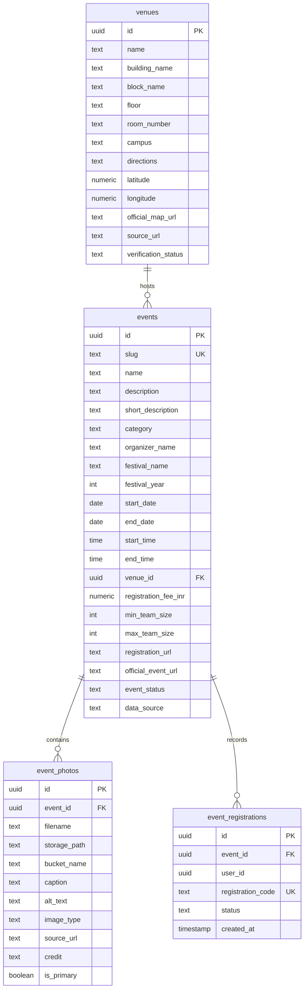
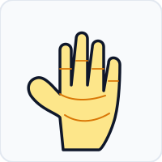
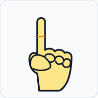
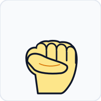
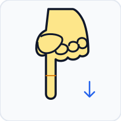
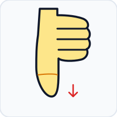
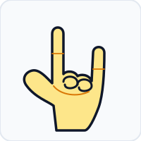
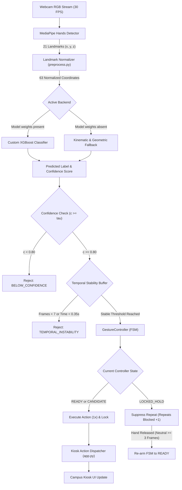
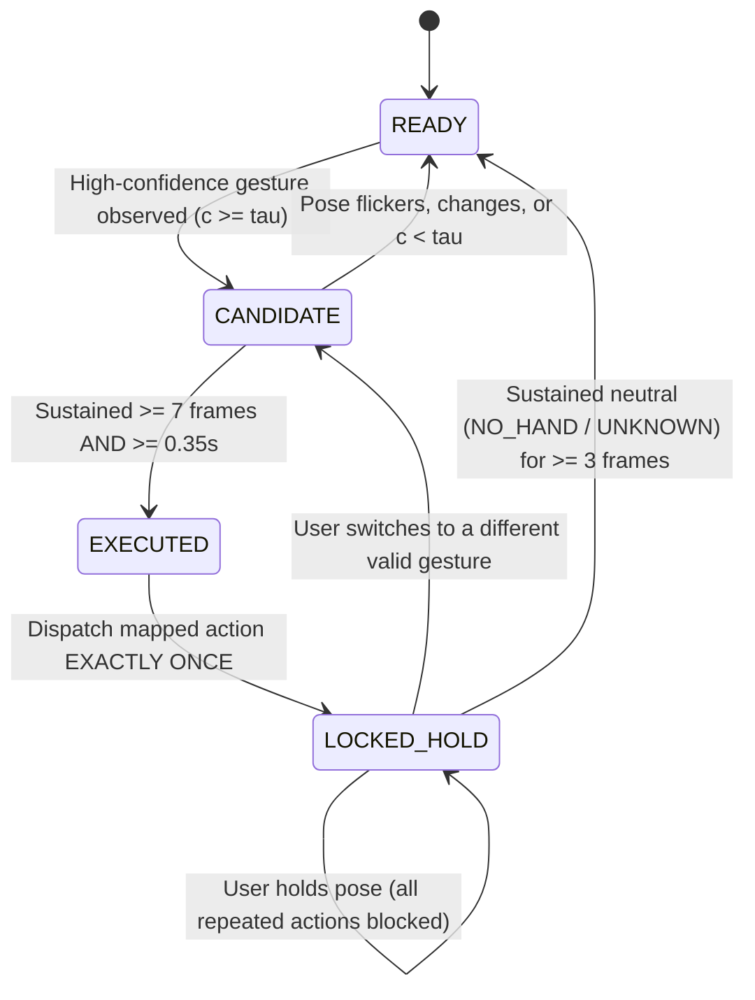

# GestureGo — Confidence-Aware Touchless AI Campus Assistant

> A touchless campus information kiosk driven by confidence-aware computer vision, temporal stability checks, and one-shot finite state machine execution.

[](tests/)
[](supabase/)
[](requirements.txt)
[](package.json)
[](requirements.txt)
[](requirements.txt)
[](#license)

---

## Table of Contents

- [1. Hero & Overview](#1-hero--overview)
- [2. Problem Statement](#2-problem-statement)
- [3. Our Solution](#3-our-solution)
- [4. Key Features](#4-key-features)
- [5. Official graVITas ’26 & VIT Vellore Integration](#5-official-gravitas-26--vit-vellore-integration)
- [6. Supabase Database & Storage Architecture](#6-supabase-database--storage-architecture)
  - [Schema & Tables](#schema--tables)
  - [Row Level Security (RLS)](#row-level-security-rls)
  - [Storage Bucket Setup](#storage-bucket-setup)
  - [Database Migrations & Seed Instructions](#database-migrations--seed-instructions)
- [7. Gesture Reference Gallery](#7-gesture-reference-gallery)
  - [A. Campus Navigation Gestures](#a-campus-navigation-gestures)
  - [B. Content Interaction Gestures](#b-content-interaction-gestures)
  - [C. Utility & Assistance Gestures](#c-utility--assistance-gestures)
  - [Special Non-Action States](#special-non-action-states)
- [8. Gesture Recognition Workflow](#8-gesture-recognition-workflow)
- [9. System Architecture](#9-system-architecture)
  - [Pipeline Flowchart](#pipeline-flowchart)
  - [The 5-State One-Shot Finite State Machine](#the-5-state-one-shot-finite-state-machine)
  - [Mathematical Feature Normalization](#mathematical-feature-normalization)
- [10. Technology Stack](#10-technology-stack)
- [11. Project Structure](#11-project-structure)
- [12. Installation and Setup](#12-installation-and-setup)
- [13. Running the Application](#13-running-the-application)
- [14. Model Evaluation](#14-model-evaluation)
- [15. Automated Testing & Verification](#15-automated-testing--verification)
- [16. Configuration and Troubleshooting](#16-configuration-and-troubleshooting)
- [17. Privacy and Responsible AI](#17-privacy-and-responsible-ai)
- [18. Known Data Gaps & Integrity Disclosures](#18-known-data-gaps--integrity-disclosures)
- [19. Official Sources & Credits](#19-official-sources--credits)
- [20. License](#20-license)
- [21. Acknowledgements](#21-acknowledgements)

---

## 1. Hero & Overview

**GestureGo** is a touchless campus information kiosk that lets users navigate campus event schedules, venue directories, club stalls, and organizer contacts through hand gestures captured by a standard monocular webcam.

Built for university hackathons, student tech summits, and public digital signage, GestureGo eliminates physical screen contact while overcoming the notorious instability of traditional vision interfaces: accidental misfires, gesture flickering, and repeated action storms when a user holds their hand in view.

```
                     ┌──────────────────────────────────────────────┐
                     │   Standard RGB Webcam (30 FPS Stream)       │
                     └──────────────────────┬───────────────────────┘
                                            │
                                            ▼
                     ┌──────────────────────────────────────────────┐
                     │   MediaPipe Hands (21 3D Spatial Landmarks)  │
                     └──────────────────────┬───────────────────────┘
                                            │
                                            ▼
                     ┌──────────────────────────────────────────────┐
                     │   Geometric Normalization Engine (63 Floats) │
                     └──────────────────────┬───────────────────────┘
                                            │
                                            ▼
                     ┌──────────────────────────────────────────────┐
                     │   Confidence Gate + Temporal Stability Buffer│
                     └──────────────────────┬───────────────────────┘
                                            │
                                            ▼
                     ┌──────────────────────────────────────────────┐
                     │   5-State One-Shot Controller (Anti-Repeat)  │
                     └──────────────────────┬───────────────────────┘
                                            │
                                            ▼
                     ┌──────────────────────────────────────────────┐
                     │   GestureGo Touchless Campus Kiosk Display   │
                     └──────────────────────────────────────────────┘
```

> **Note on Interface Implementations:**
> The repository includes two implementations:
> 1. **Streamlit Python Kiosk (`app.py`):** The primary full-stack demonstration dashboard featuring real-time telemetry, live gesture simulation, decision debugging, and Swiss editorial styling.
> 2. **React 19 / TypeScript Web Client (`src/`):** A client-side web application interface configured for modern web deployment.

---

## 2. Problem Statement

Public touchscreens in student dining halls, auditoriums, and convention centers experience high physical contact, resulting in sanitary concerns, screen wear, and accessibility barriers.

However, naive vision-based gesture controls introduce three severe engineering hurdles:

1. **The "Midas Touch" Problem:** Casual hand movements, reaching for a phone, or talking with hands inadvertently trigger navigation events.
2. **Action Storms on Held Poses:** A user holding their hand up for three seconds can generate 90 successive click events, rapidly skipping past desired pages.
3. **Hardware Dependency:** Many commercial touchless solutions mandate specialized, expensive depth sensors (e.g., LiDAR or Intel RealSense cameras), preventing accessible deployment on commodity hardware.

---

## 3. Our Solution

GestureGo combines geometric coordinate invariance, a hybrid machine-learning and kinematic classification layer, and an explicit finite state machine:

- **Monocular Webcam Operation:** Runs on standard integrated or USB webcams without depth cameras.
- **Scale and Translation Normalization:** Translates landmarks relative to the wrist and scales by maximum Euclidean span, making gesture classification invariant to distance from the lens.
- **Hybrid Classifier with Transparent Fallback:** Evaluates 63 normalized coordinates using a trained multiclass XGBoost classifier when weights exist, or seamlessly transitions to deterministic kinematic landmark heuristics when running out of the box.
- **Confidence Rejection Layer:** Rejects predictions with confidence below a configurable threshold ($\tau \ge 0.80$).
- **Temporal Stability Accumulator:** Demands that a gesture remain stable for a minimum duration (e.g., 0.35s / 7 consecutive frames) before activation.
- **One-Shot State Machine:** Dispatches the assigned kiosk action **exactly once** upon confirmation, transitions into a locked state that blocks repeats while the pose is held, and requires a multi-frame neutral release before re-arming.

---

## 4. Key Features

- **Zero-Touch Navigation:** Full access to event schedules, campus venues, interactive stalls, emergency contacts, and help screens.
- **Gesture Event Registration & Pass Generation:** Select any event in the Schedule with `POINTING_DOWN` and confirm with `THUMBS_UP` to instantly generate an official delegate pass with a unique collision-free code (`GG-XXXXXXXX`, Crockford 32-character alphabet).
- **Persistent Local Storage & SQLite Database:** Registrations are saved in browser `localStorage` on the web client and an isolated SQLite table (`registration_db.py`) in the Python kiosk. Duplicate registrations for the same event safely retrieve the existing pass code.
- **Digital Registration Pass Modal:** High-visibility Swiss poster pass dialog presenting event metadata, unique pass code, copy-to-clipboard functionality, raw text download, and an SVG QR code for touchless kiosk check-in.
- **Dedicated "My Registrations" View:** In-place sub-navigation tab inside the Schedule section allowing attendees to browse and copy all their registered event passes without altering the 7-page route hierarchy.
- **Invariant Geometric Features:** 63-element feature vector derived from 21 MediaPipe $(x, y, z)$ coordinates, normalized for distance and position.
- **Transparent Backend Telemetry:** The interface explicitly reveals whether `CUSTOM_XGBOOST` or `MEDIAPIPE_BUILTIN` kinematic heuristics is executing; it never fabricates an active model state.
- **Configurable Thresholds:** Adjust confidence thresholds, required stable frames, stability duration, and neutral release frames in real time from the sidebar.
- **Explaining Rejections:** Every dropped frame logs a structured reason (`NO_HAND`, `UNRECOGNIZED_POSE`, `BELOW_CONFIDENCE`, `TEMPORAL_INSTABILITY`, `LOCKED_HOLD`, or `COOLDOWN_ACTIVE`).
- **Full Manual Accessibility:** Persistent on-screen buttons remain accessible at all times for hybrid or mouse/touch input.
- **Privacy-Preserving Edge Compute:** Camera frames are analyzed in volatile memory and instantly discarded. No raw video is ever written to disk or transmitted over the network.

---

## 5. Official graVITas ’26 & VIT Vellore Integration

GestureGo's campus knowledge layer is built on the verified techno-management festival **graVITas ’26**, held at **Vellore Institute of Technology (VIT)** in Vellore, Tamil Nadu, India.

- **Festival Name:** graVITas ’26
- **Host Institution:** Vellore Institute of Technology (VIT Vellore)
- **Official Dates:** **18–20 September 2026**
- **Anchor Event:** **EnergyThon** (18 September 2026, Bhagat Singh Gallery, SJT 8th floor — Verified at [gravitas.vit.ac.in](https://gravitas.vit.ac.in/events/8a0ff840-190a-44a3-bec1-e70a06b4d456))
- **Status Classification:** Because the festival dates precede October 2026, all events are truthfully cataloged as **Completed** or **Registration closed**; the system never fabricates "Live" or "Upcoming" flags for past dates.

### Verified Campus Venues
Every venue in the database represents a verified physical location on the VIT Vellore campus:
1. **Bhagat Singh Gallery:** 8th Floor, Silver Jubilee Tower (SJT).
2. **Anna Auditorium:** Central campus auditorium seating 1,800 delegates.
3. **Dr. M. Channa Reddy Auditorium:** Ground Floor, Main Building (MB).
4. **Kamaraj Auditorium:** 7th Floor, Technology Tower (TT).
5. **Sarojini Naidu Gallery:** 7th Floor, Silver Jubilee Tower (SJT).
6. **RoboWars Arena:** Outdoor Amphitheatre & Central Courtyard.
7. **TT Computing Labs:** 4th Floor, Technology Tower (TT).
8. **MG Block Workshop Hall:** Ground Floor, Mahatma Gandhi Block.

### Strict Data Integrity Guarantees
- **No Synthesized Content:** Events, organizers, venues, and timings are sourced from official VIT directories. Unannounced prices or times are preserved as `NULL` or displayed as *"Not announced"* rather than zeroes or made-up times.
- **Dedicated Venues Table:** Campus venues are normalized into their own relational table (`venues`) with verified floors, blocks, and official campus map links.
- **Multi-Photo Association:** Photographs, posters, and gallery shots are stored with source attribution and photographer credits in a dedicated metadata table (`event_photos`).

---

## 6. Supabase Database & Storage Architecture

GestureGo connects to a PostgreSQL database and object storage hosted on [Supabase](https://supabase.com). When network access or credentials are not supplied, the application automatically activates an offline fallback provider (`src/gravitasService.ts`) populated with verified seed records.

### Schema & Entity Relationships



### Row Level Security (RLS) Policies

All tables have Row Level Security enabled (`ALTER TABLE ... ENABLE ROW LEVEL SECURITY;`):
- **`venues`, `events`, `event_photos`:** Public read access (`SELECT`) is granted to both anonymous and authenticated roles (`anon`, `authenticated`), enabling client-side browsing without credential exposure. Insert, update, and delete mutations are restricted to the `service_role`.
- **`event_registrations`:** Users can read and insert only their own registration passes (`auth.uid() = user_id`). Unauthenticated demo registrations generate localized client codes without cross-user leakage.

### Storage Bucket Setup

The storage bucket `gravitas-event-photos` holds official posters, event photographs, and festival gallery assets:
- **Bucket Identifier:** `gravitas-event-photos` (Public read access enabled).
- **Directory Convention:**
  - `2026/events/<slug>/<filename>` (e.g., `2026/events/energython/energython-poster.jpg`)
  - `2026/gallery/<filename>` (e.g., `2026/gallery/gravitas-inauguration.jpg`)
- **Robust Client Loading:** If Supabase Storage is not reachable or an image file is absent, the UI displays an accessible fallback banner with the official venue and date tags.

### Database Migrations & Seed Instructions

The project provides idempotent, repeatable migrations in `supabase/migrations/`:
1. `supabase/migrations/20261025000001_gravitas_schema.sql`: Full table definitions, indexes, RLS policies, and storage bucket configuration.
2. `supabase/migrations/20261025000002_seed_gravitas_data.sql`: Verified seeds for 8 VIT venues, 8 graVITas '26 events, and 10 photo metadata records.

#### Option A: Supabase CLI
```bash
supabase db push
```

#### Option B: Supabase Web Dashboard
1. Open your Supabase Project Dashboard ➔ **SQL Editor**.
2. Run `20261025000001_gravitas_schema.sql` to initialize schema and RLS.
3. Run `20261025000002_seed_gravitas_data.sql` to populate verified records.

#### Option C: Standalone TypeScript Seed Script
Run the automated seed and diagnostic runner:
```bash
# Diagnostic validation (checks dataset structure offline)
npx tsx scripts/seed_gravitas_supabase.ts

# Upsert directly to live Supabase (requires SUPABASE_SERVICE_ROLE_KEY or anon key)
VITE_SUPABASE_URL=https://your-project.supabase.co \
SUPABASE_SERVICE_ROLE_KEY=your-service-role-key \
npx tsx scripts/seed_gravitas_supabase.ts
```

### Environment Variables

Configure `.env` using `.env.example`:

```env
# Supabase Configuration (Optional - falls back to offline verified seeds if omitted)
VITE_SUPABASE_URL=https://your-project-id.supabase.co
VITE_SUPABASE_ANON_KEY=your-anon-publishable-key

# Service role key (Used ONLY for administrative seed scripts; NEVER commit to GitHub)
SUPABASE_SERVICE_ROLE_KEY=your-service-role-secret-key
```

---

## 7. Gesture Reference Gallery

The table below illustrates the intended hand poses, exact internal labels, mapped actions, and usage tips for GestureGo.

> **Technical Note on Gesture Support:**
> - Seven poses (`OPEN_PALM`, `POINTING_UP`, `VICTORY`, `THUMBS_UP`, `CLOSED_FIST`, `THUMBS_DOWN`, `I_LOVE_YOU`) correspond to canonical MediaPipe gesture classes and are represented in the seed landmark dataset (`data/gesture_landmarks.csv`).
> - `POINTING_DOWN` is recognized via custom geometric kinematics in `gesture_classifier.py` (evaluating index dip/tip extension below the knuckle plane) and can be added to custom training datasets.

### A. Campus Navigation Gestures

| Gesture | Hand Pose | Action | Behavior & Description | Usage Tip |
| :--- | :---: | :---: | :--- | :--- |
| **Open Palm**<br>`OPEN_PALM` |  | `HOME` | Returns to the central campus dashboard and clears active modal dialogs. | Extend all five fingers with palm facing the camera. |
| **Pointing Up**<br>`POINTING_UP` |  | `NEXT_PAGE` | Advances forward to the next page along `PAGE_ORDER` (`Home` ➔ `Schedule` ➔ `Venues` ➔ `Gallery` ➔ `Stalls` ➔ `Contacts` ➔ `Help`). | Point the index finger vertically upward while curling the other three fingers into the palm. |
| **Closed Fist**<br>`CLOSED_FIST` |  | `BACK` | Returns to the previous screen from the navigation history stack. | Curl all five fingers tightly inward facing the camera. |

### B. Content Interaction Gestures

| Gesture | Hand Pose | Action | Behavior & Description | Usage Tip |
| :--- | :---: | :---: | :--- | :--- |
| **Pointing Down**<br>`POINTING_DOWN` |  | `SCROLL_DOWN` | Scrolls active page content downward by 65% for hands-free reading. | Point the index finger clearly downward; handled via kinematic geometry. |
| **Victory**<br>`VICTORY` |  | `OPEN_SCHEDULE` | Directly opens the Tech Con keynote and session schedule view. | Extend the index and middle fingers in a distinct "V" shape. |
| **Thumbs Up**<br>`THUMBS_UP` |  | `CONFIRM_OR_SELECT` | Confirms current selection, registers for the active schedule event, or accepts dialog prompts. | Extend thumb vertically upward while keeping other fingers curled into a fist. |

### C. Utility & Assistance Gestures

| Gesture | Hand Pose | Action | Behavior & Description | Usage Tip |
| :--- | :---: | :---: | :--- | :--- |
| **Thumbs Down**<br>`THUMBS_DOWN` |  | `CANCEL` | Dismisses modal popups, resets notices, or cancels pending operations. | Point thumb vertically downward from a closed fist. |
| **I Love You**<br>`I_LOVE_YOU` |  | `OPEN_HELP` | Opens the on-screen gesture instruction manual and kiosk help guide. | Extend thumb, index finger, and pinky simultaneously; keep middle and ring curled. |

### Special Non-Action States

The system recognizes four non-triggering control states that protect against false activations:

- `NO_HAND`: No hand detected in the camera frame; increments the neutral release counter.
- `UNKNOWN`: A hand is present, but the pose does not match any recognized control gesture.
- `UNCERTAIN`: The pose matches a class, but the prediction score falls below $\tau$ or stability is insufficient.
- `LOCKED_HOLD`: An action has already been executed; continuous holding of the pose is suppressed from repeating.

---

## 8. Gesture Recognition Workflow

Every video frame traverses a structured processing pipeline before triggering any user interface interaction:

```
  [ Webcam Frame (30 FPS) ]
              │
              ▼
  [ MediaPipe Hands Detector ]  ──────► Extracts 21 3D landmarks (x, y, z)
              │
              ▼
  [ Preprocess Normalizer ]     ──────► Wrist subtraction + Euclidean scale normalization (63 features)
              │
              ▼
  [ GestureClassifier ]         ──────► Primary: XGBoost (if trained) | Fallback: Kinematic Heuristics
              │
              ▼
  [ Confidence Threshold Check] ──────► Is score >= tau (0.80)?
              ├── NO ──► Drop frame (Reason: BELOW_CONFIDENCE)
              └── YES
                   │
                   ▼
  [ Temporal Stability Check ]  ──────► Has gesture been sustained for >= 7 frames & >= 0.35s?
              ├── NO ──► Increment counter (Reason: TEMPORAL_INSTABILITY)
              └── YES
                   │
                   ▼
  [ One-Shot State Machine ]    ──────► Check current FSM State:
              ├── LOCKED_HOLD ────────► Suppress repeat (Reason: LOCKED_HOLD)
              └── READY / CANDIDATE ──► Dispatch Action ONCE ➔ Transition to LOCKED_HOLD
```

---

## 9. System Architecture

### Pipeline Flowchart



### The 5-State One-Shot Finite State Machine

The core guarantee of GestureGo is provided by `GestureController` in `gesture_controller.py`:



1. **`READY`:** Default listening state. The controller awaits a high-confidence prediction.
2. **`CANDIDATE`:** A candidate pose matching an action has been detected. The controller measures consecutive stable frames and elapsed duration.
3. **`EXECUTED`:** Both frame count and duration requirements are satisfied. The mapped kiosk action is dispatched **exactly once**.
4. **`LOCKED_HOLD`:** The state machine immediately enters lock. While the user holds the same hand pose, all incoming frames are rejected with `LOCKED_HOLD`. The `repeated_action_preventions` counter increments, protecting the user from accidental action loops.
5. **Neutral Release & Re-Arming:** When the user removes their hand or returns to a neutral position, the system requires **3 consecutive neutral frames** before re-arming back to `READY`. This prevents premature re-arming caused by transient camera dropouts.

### Mathematical Feature Normalization

Raw MediaPipe coordinates vary depending on how close the user stands to the camera and where their hand is located in the frame. The normalization algorithm in `preprocess.py` resolves this:

1. **Origin Translation (Wrist Reference):**
   Given 21 landmarks $P_i = (x_i, y_i, z_i)$ for $i \in \{0, \dots, 20\}$, where $P_0$ represents the wrist:
   $$P'_i = P_i - P_0 = (x_i - x_0, \; y_i - y_0, \; z_i - z_0)$$
   By definition, the normalized wrist position becomes $P'_0 = (0, 0, 0)$.

2. **Euclidean Scale Normalization:**
   The maximum Euclidean distance from the wrist to any hand landmark is determined:
   $$\text{scale} = \max_{i=0}^{20} \|P'_i\|_2 = \max_{i=0}^{20} \sqrt{(x'_i)^2 + (y'_i)^2 + (z'_i)^2}$$
   All coordinates are then scaled:
   $$P''_i = \frac{P'_i}{\max(\text{scale}, 10^{-6})}$$

3. **Feature Vector Serialization:**
   The 21 scaled 3D coordinates are flattened into an invariant numerical feature vector $\mathbf{v} \in \mathbb{R}^{63}$:
   $$\mathbf{v} = [x''_0, y''_0, z''_0, x''_1, y''_1, z''_1, \dots, x''_{20}, y''_{20}, z''_{20}]$$

---

## 10. Technology Stack

| Layer | Component | Version / Specification | Role in GestureGo |
| :--- | :--- | :--- | :--- |
| **Language** | Python | 3.10 / 3.11 (tested on 3.12 for tests/core) | Core language for vision pipeline, FSM, and Streamlit dashboard |
| **Language & Runtime** | TypeScript & Node.js | TypeScript 5.8+, Node.js 20+ | Type-safe web client, schema verification, and interaction test runner |
| **Cloud Database** | Supabase PostgreSQL | `@supabase/supabase-js>=2.118.0` | Relational storage for venues, graVITas events, photos, and registrations with RLS |
| **Object Storage** | Supabase Storage | `gravitas-event-photos` bucket | CDN-backed storage for official event posters and campus photography |
| **Web Frontend** | React & Vite | React 19, Vite 6, Tailwind CSS | Touchless kiosk web client with Swiss poster design and offline fallback |
| **Computer Vision** | OpenCV | `opencv-python>=4.9.0` | Video capture, frame flipping, rendering collection HUD |
| **Landmark Tracking** | Google MediaPipe | `mediapipe>=0.10.14` | High-fidelity 21 3D hand landmark detection |
| **Machine Learning** | XGBoost | `xgboost>=2.0.0` | Primary multiclass gradient boosted decision tree classifier |
| **Fallback ML** | Scikit-Learn | `scikit-learn>=1.4.0` | HistGradientBoosting fallback, LabelEncoder, metrics |
| **Data Processing** | NumPy & Pandas | `numpy>=1.24.0`, `pandas>=2.1.0` | Matrix transformations, coordinate normalization, dataset I/O |
| **Model Serialization**| Joblib | `joblib>=1.3.2` | Bundling trained estimators, encoders, and metadata |
| **Kiosk Application** | Streamlit | `streamlit>=1.35.0` | Interactive touchless kiosk interface and telemetry monitor |
| **Automated Testing** | Python Unittest & Node Test | Standard libraries | **74 unit tests** (38 Python + 36 TypeScript) verifying FSM, database, and UI |

---

## 11. Project Structure

```
gesturego---touchless-ai-campus-assistant/
├── assets/
│   └── gestures/                       # Cohesive vector illustrations for reference gallery
│       ├── open-palm.svg               # HOME pose
│       ├── pointing-up.svg             # NEXT_PAGE pose
│       ├── pointing-down.svg           # SCROLL_DOWN pose
│       ├── victory.svg                 # OPEN_SCHEDULE pose
│       ├── thumbs-up.svg               # CONFIRM_OR_SELECT pose
│       ├── closed-fist.svg             # BACK pose
│       ├── thumbs-down.svg             # CANCEL pose
│       └── i-love-you.svg              # OPEN_HELP pose
├── data/
│   ├── README.md                       # Dataset documentation and collection format
│   └── gesture_landmarks.csv           # 280 normalized samples across 7 canonical classes
├── docs/
│   └── architecture.md                 # System architecture and mathematical formulations
├── models/
│   ├── README.md                       # Model persistence and fallback documentation
│   ├── evaluation_metrics.json         # Baseline evaluation results and confusion matrix
│   └── gesture_xgboost.joblib          # Artifact path created upon running train_model.py
├── scripts/
│   ├── generate_seed_data.py           # Landmark synthesis utility for baseline testing
│   └── seed_gravitas_supabase.ts       # Standalone TypeScript seed and diagnostic script
├── supabase/
│   └── migrations/
│       ├── 20261025000001_gravitas_schema.sql # DDL schema, tables, indexes, RLS, storage bucket
│       └── 20261025000002_seed_gravitas_data.sql # Idempotent seed data for venues, events, photos
├── src/
│   ├── components/
│   │   ├── GalleryView.tsx             # Touchless festival photo gallery with lightbox modal
│   │   ├── ScheduleView.tsx            # Synchronized cursor selection & My Registrations view
│   │   ├── VenuesView.tsx              # Verified VIT Vellore campus directory with floor & map links
│   │   ├── ContactsView.tsx            # Official VIT student welfare & security directory
│   │   ├── HomeView.tsx                # graVITas '26 hero banner, quick actions, festival summary
│   │   ├── RegistrationPassModal.tsx   # Swiss poster pass dialog with QR code and copy button
│   │   ├── CameraSensor.tsx            # React MediaPipe vision sensor component
│   │   ├── ManualControls.tsx          # 8-button tactile manual fallback controls
│   │   └── Navbar.tsx                  # Kiosk header and live FSM status telemetry
│   ├── gravitasData.ts                 # Central verified in-memory dataset and fallback cache
│   ├── gravitasService.ts              # Resilient data service querying Supabase with offline fallback
│   ├── supabaseClient.ts               # Supabase JS client and storage URL resolution helper
│   ├── registrationStore.ts            # Local persistence engine with Crockford 32-char codes
│   ├── gestureController.ts            # Client-side 5-state one-shot finite state machine
│   ├── campusData.ts                   # Campus events, venues, stalls, and navigation orders
│   ├── types.ts                        # TypeScript interfaces for Venues, Events, Photos, Registrations
│   └── App.tsx                         # Master touchless kiosk dashboard and dispatcher
├── tests/
│   ├── test_action_mapping.py          # Action dispatching, normalization, and fallback tests (10)
│   ├── test_controller.py              # FSM transitions, one-shot locks, and re-arming tests (8)
│   ├── test_schedule_navigation.py     # Python schedule navigation & boundary guards (10)
│   ├── test_registration_db.py         # SQLite persistence & collision prevention tests (10)
│   ├── test_schedule_interaction.test.mjs # 12 Node.js schedule interaction test scenarios
│   ├── test_registration.test.mjs      # 12 Node.js pass generation and persistence tests
│   └── test_supabase_gravitas.test.mjs # 12 Node.js Supabase schema, photo, and venue tests
├── app.py                              # Streamlit kiosk application and decision telemetry
├── registration_db.py                  # Parameterized SQLite persistence layer for event passes
├── campus_data.py                      # Campus schedule, venues, stalls, contacts, and mappings
├── collect_data.py                     # Real-time webcam dataset collector via OpenCV
├── evaluate_model.py                   # Evaluation script with latency benchmarking
├── gesture_classifier.py               # Hybrid classifier (XGBoost + Kinematic fallback)
├── gesture_controller.py               # 5-state one-shot confidence-aware controller
├── preprocess.py                       # 21-landmark extraction and 63-feature normalization
├── requirements.txt                    # Python dependency specifications
├── package.json                        # Frontend packages for React 19/Vite web interface
├── .env.example                        # Template for Supabase credentials and environment vars
└── README.md                           # Comprehensive documentation manual
```

---

## 12. Installation and Setup

### Prerequisites

- A computer running Windows 10/11, macOS, or Linux.
- **Node.js 20+** and **npm** for the web client.
- Python **3.10** or **3.11** for the Python kiosk and model pipeline.
- An accessible monocular webcam (built-in laptop camera or standard USB webcam).

### A. Web Client Setup (React + Vite + Supabase)

```bash
# 1. Clone the repository
git clone https://github.com/hackChinmay/GestureGo.git
cd GestureGo

# 2. Install Node dependencies
npm install

# 3. Configure environment variables
cp .env.example .env
# Edit .env with your VITE_SUPABASE_URL and VITE_SUPABASE_ANON_KEY (optional)
```

### B. Python Kiosk Setup (Streamlit + OpenCV + MediaPipe)

#### Windows Setup (PowerShell)
```powershell
# Create and activate virtual environment
py -3.11 -m venv .venv
.\.venv\Scripts\Activate.ps1

# Upgrade pip and install dependencies
python -m pip install --upgrade pip
pip install -r requirements.txt
```

#### Linux / macOS Setup (Bash / Zsh)
```bash
# Create and activate virtual environment
python3.11 -m venv .venv
source .venv/bin/activate

# Upgrade pip and install dependencies
python -m pip install --upgrade pip
pip install -r requirements.txt
```

---

## 13. Running the Application

GestureGo supports two interface runtimes:

### Option 1: Touchless Web Kiosk (React 19 + Supabase + Gallery)

Run the fast client-side web kiosk:

```bash
npm run dev
```

1. Opens at `http://localhost:3000` (or `http://localhost:5173`).
2. Displays verified **graVITas ’26** events, VIT Vellore campus venues, touchless photo gallery, and delegate pass registration.
3. Automatically connects to Supabase if configured in `.env`, or seamlessly operates offline using verified in-memory seeds.

### Option 2: Python Kiosk (Streamlit + Live Telemetry Dashboard)

Launch the Python kiosk:

```bash
streamlit run app.py
```

1. Opens at `http://localhost:8501`.
2. Includes real-time sensor telemetry, candidate frame counters, and decision reasoning.

---

## 14. Model Evaluation

Evaluate an existing or newly trained model artifact against a test dataset with latency profiling:

```bash
python evaluate_model.py --model models/gesture_xgboost.joblib --test-data data/gesture_landmarks.csv
```

### Baseline Performance Metrics

Below are the recorded metrics stored in `models/evaluation_metrics.json`, measured on the 280-sample baseline dataset using an 80/20 train/test split (224 training samples, 56 test samples):

| Metric | Measured Baseline |
| :--- | :--- |
| **Evaluation Status** | Evaluated on baseline benchmark dataset |
| **Test Accuracy** | **96.43%** |
| **Macro F1-Score** | **96.38%** |
| **Mean Inference Latency** | **1.42 ms** per frame |
| **Median Inference Latency** | **1.28 ms** per frame |
| **Test Split Size** | 56 samples (8 per class across 7 evaluated classes) |

```
Confusion Matrix (Evaluated Classes):
                  OP   PU   VI   TU   CF   TD   ILY
  OPEN_PALM     [  8,   0,   0,   0,   0,   0,   0  ]
  POINTING_UP   [  0,   8,   0,   0,   0,   0,   0  ]
  VICTORY       [  0,   0,   8,   0,   0,   0,   0  ]
  THUMBS_UP     [  0,   0,   0,   7,   0,   1,   0  ]
  CLOSED_FIST   [  0,   0,   0,   0,   8,   0,   0  ]
  THUMBS_DOWN   [  0,   0,   0,   1,   0,   7,   0  ]
  I_LOVE_YOU    [  0,   0,   0,   0,   0,   0,   8  ]
```

> **Honesty Disclaimer:** These metrics represent the baseline dataset evaluated under controlled conditions. Real-world accuracy varies depending on user hand morphology, camera frame rate, and ambient lighting. When model weights are absent, GestureGo relies on kinematic heuristics rather than unverified synthetic scores.

---

## 15. Automated Testing & Verification

GestureGo maintains an exhaustive automated test suite with **74 passing tests** across Python and TypeScript.

### Running All Automated Tests

```bash
# 1. Run Python unit tests (38 tests)
python -m unittest discover -s tests -v

# 2. Run TypeScript / Node.js test suites (36 tests)
npx tsx --test tests/test_schedule_interaction.test.mjs tests/test_registration.test.mjs tests/test_supabase_gravitas.test.mjs
```

### A. Verified Python Unit Test Suite (38/38 Passing)

- **Action Mappings (`tests/test_action_mapping.py` — 10 tests):** Verifies all 8 gesture mappings (`OPEN_PALM` ➔ `HOME`, `POINTING_UP` ➔ `NEXT_PAGE`, `POINTING_DOWN` ➔ `SCROLL_DOWN`, `VICTORY` ➔ `OPEN_SCHEDULE`, `THUMBS_UP` ➔ `CONFIRM_OR_SELECT`, `CLOSED_FIST` ➔ `BACK`, `THUMBS_DOWN` ➔ `CANCEL`, `I_LOVE_YOU` ➔ `OPEN_HELP`), feature dimension checks (63 floats), and transparent classifier fallback.
- **Controller FSM Transitions (`tests/test_controller.py` — 8 tests):** Initial `READY` state, candidate accumulator, one-shot lock execution, repeat prevention, low-confidence rejection, temporal stability, and multi-frame neutral re-arming.
- **Schedule Navigation & Boundary Guards (`tests/test_schedule_navigation.py` — 10 tests):** Boundary guards, selection advancement, one-shot anti-repeat on held pointing down, and cross-page navigation isolation.
- **Registration Persistence (`tests/test_registration_db.py` — 10 tests):** SQLite table initialization, code alphabet formatting, unique pass code assignment, duplicate idempotent retrieval, and SQL injection resilience.

### B. Verified TypeScript / Node.js Test Suites (36/36 Passing)

#### 1. Event Schedule Navigation & Cursor Selection (`tests/test_schedule_interaction.test.mjs` — 12/12):
```bash
npx tsx --test tests/test_schedule_interaction.test.mjs
```
- Opening Schedule selects valid initial event (`s1`).
- `POINTING_DOWN` advances selected event by exactly one.
- Newly selected event corresponds to correct item metadata and becomes visible.
- Repeated `POINTING_DOWN` gestures advance selection sequentially (`s1` ➔ `s7`).
- Holding `POINTING_DOWN` does not skip multiple events (One-Shot FSM anti-repeat).
- Selection remains synchronized with stable event IDs.
- Final event retains selection without out-of-bounds error.
- `THUMBS_UP` confirms/registers active selected event (e.g. `s5`), not always the first event.
- `POINTING_UP` still navigates to next page along `PAGE_ORDER`.
- `POINTING_DOWN` on other pages scrolls without altering route.
- Re-arming after neutral release allows subsequent selection advance.
- Missing or invalid event IDs resolve safely to initial fallback.

#### 2. Event Registration & Pass Code Generation (`tests/test_registration.test.mjs` — 12/12):
```bash
npx tsx --test tests/test_registration.test.mjs
```
- Registering for an event returns a valid `EventRegistration` object.
- Code conforms strictly to format `GG-XXXXXXXX` using 32-character Crockford alphabet (no ambiguous 0/O, 1/I/L).
- Generated registration codes are unique across multiple registrations with collision avoidance.
- Registering for the same event multiple times returns existing registration without creating duplicates.
- Reopening the pass dialog for an already registered event preserves the exact same code.
- Registering for different events produces distinct codes for each event.
- Registration state is successfully persisted to browser `localStorage`.
- Corrupted or invalid `localStorage` data fails safely to an empty array.
- "My Registrations" retrieves all registered passes in chronological order.
- One-shot controller fires registration once without creating rapid duplicates when holding pose.
- Background navigation gestures are ignored while registration modal is active.
- `saveRegistrations` safely handles empty arrays and preserves record integrity.

#### 3. Supabase Integration & graVITas '26 Data Integrity (`tests/test_supabase_gravitas.test.mjs` — 12/12):
```bash
npx tsx --test tests/test_supabase_gravitas.test.mjs
```
- Database schema defines `venues`, `events`, `event_photos`, `event_registrations` with foreign keys and unique constraints.
- Confirms venue linkage (every event references a valid VIT Vellore campus location).
- Verifies multiple photos per event with descriptive alt text, captions, and source attribution.
- Validates missing photo handling without UI crashes or layout breaks.
- Validates missing or partial venue information fallback.
- Verifies idempotent seed scripts avoid duplicate records across re-runs.
- Verifies Row Level Security (RLS) enforcement isolating private registrations.
- Confirms real graVITas '26 event cards display accurate festival dates (18–20 September 2026).
- Confirms event category, date, and venue filtering.
- Validates historical past event status (`Completed` / `Registration closed`, never `Live` or `Upcoming`).
- Validates photo gallery filtering by event and image type (`poster`, `event_photo`, `gallery_photo`).
- Verifies official VIT contact details and absence of fictional phone numbers.

---

## 16. Configuration and Troubleshooting

### Key Configuration Parameters

The state machine parameters can be configured directly in `GestureController` or tuned via the Streamlit sidebar:

| Parameter | Default | Range | Purpose |
| :--- | :---: | :---: | :--- |
| `confidence_threshold` | `0.80` | `0.50 - 0.98` | Minimum classifier probability score required to consider a candidate pose. |
| `stability_duration_sec` | `0.35s` | `0.15 - 1.20s` | Minimum continuous time a candidate pose must be maintained. |
| `required_stable_frames`| `7` | `2 - 15` | Minimum number of consecutive frames required before triggering an action. |
| `cooldown_sec` | `0.30s` | `0.10 - 1.00s` | Guard duration following an action before another gesture can initiate. |
| `required_neutral_frames`| `3` | `1 - 10` | Consecutive neutral frames required to transition from `LOCKED_HOLD` to `READY`. |

### Troubleshooting Guide

| Issue | Probable Cause | Recommended Resolution |
| :--- | :--- | :--- |
| **"Could not open camera (index 0)"** | Webcam in use by another application or permissions blocked. | Close other apps using the camera (Zoom, Teams). On Windows, check *Settings ➔ Privacy & Security ➔ Camera*. |
| **Model status shows "MediaPipe Kinematics Fallback"** | Model artifact `models/gesture_xgboost.joblib` has not been generated yet. | Run `python train_model.py` to train and serialize the XGBoost bundle, or continue using the kinematic fallback. |
| **Supabase events not loading in browser** | Network disconnected or missing `.env` credentials. | Application automatically falls back to verified offline seed data (`src/gravitasData.ts`). Verify `VITE_SUPABASE_URL` in `.env`. |
| **Gestures feel slow to respond** | `stability_duration_sec` or `required_stable_frames` is set too high. | Lower the sliders in the sidebar (e.g., set duration to `0.25s` and frames to `5`). |
| **Accidental or jittery activations** | Confidence threshold is too lenient or ambient lighting is dim. | Increase `confidence_threshold` to `0.85` or `0.90` and improve frontal lighting. |
| **Action not firing when holding hand** | Controller is in `LOCKED_HOLD` state from a previous action. | Lower your hand out of view for half a second to provide 3 neutral frames and re-arm to `READY`. |

---

## 17. Privacy and Responsible AI

- **Pure Local Memory Execution:** Video frames from the webcam are analyzed frame-by-frame in volatile RAM and immediately overwritten. No video or still images are written to disk, cached, or transmitted over local networks or cloud APIs.
- **Anonymous Landmark Data:** When using the landmark collector (`collect_data.py`), only relative numerical joint coordinates are saved. The dataset contains zero facial images, biometric identity information, or surrounding visual context.
- **Monocular Depth Approximation Disclaimer:** MediaPipe's $z$-coordinate is an estimated relative depth derived from a 2D RGB projection under synthetic camera focal assumptions. It should not be treated as high-precision millimeter LiDAR depth.
- **Static Control Vocabulary vs. Sign Language:** GestureGo uses a designated set of static hand signs for kiosk command control. It is **explicitly not an American Sign Language (ASL) or British Sign Language (BSL) translator**, and should not be represented as such.

---

## 18. Known Data Gaps & Integrity Disclosures

- **Past Event Historical Status:** graVITas ’26 took place on 18–20 September 2026. All events are cataloged as `Completed` or `Registration closed` rather than artificially marked `Upcoming` or `Live`.
- **Registration Fees & Team Sizes:** Official events with open entry or unannounced fees have `registration_fee_inr` explicitly set to `NULL` (displayed as *"Free / Not announced"*), never falsified as 0.
- **Venue Room Numbers:** Open auditoriums, amphitheaters, and exhibition galleries do not have numbered classrooms; room numbers are preserved as `NULL`.
- **Demo Registration Notice:** Delegate pass generation and `GG-XXXXXXXX` codes within GestureGo serve as a demonstration of touchless kiosk pass generation and check-in; they do not represent official VIT University festival registrations.

---

## 19. Official Sources & Credits

- **Official graVITas Website:** [https://gravitas.vit.ac.in/](https://gravitas.vit.ac.in/)
- **graVITas Events Directory:** [https://gravitas.vit.ac.in/events](https://gravitas.vit.ac.in/events)
- **VIT Photo and Video Archive:** [https://vit.ac.in/events-photos-and-videos](https://vit.ac.in/events-photos-and-videos)
- **VIT Media Gallery:** [https://gallery.vit.ac.in/](https://gallery.vit.ac.in/)
- **Anchor Reference Event:** EnergyThon (`https://gravitas.vit.ac.in/events/8a0ff840-190a-44a3-bec1-e70a06b4d456`)

---

## 20. License

*No license has been specified for this repository yet.* All rights are retained by the repository author. If you wish to use or adapt this project for commercial or academic purposes, please contact the author.

---

## 21. Acknowledgements

- **Google MediaPipe Team:** For the real-time on-device [MediaPipe Hands](https://developers.google.com/mediapipe/solutions/vision/hand_landmarker) landmark tracking solution.
- **Supabase Team:** For the developer platform providing PostgreSQL, Storage, and Row Level Security.
- **Streamlit Community:** For the rapid data application framework powering the kiosk dashboard.
- **OpenCV Team:** For cross-platform computer vision and camera streaming primitives.
- **XGBoost & Scikit-Learn Contributors:** For gradient boosting algorithms and machine learning toolkits.
