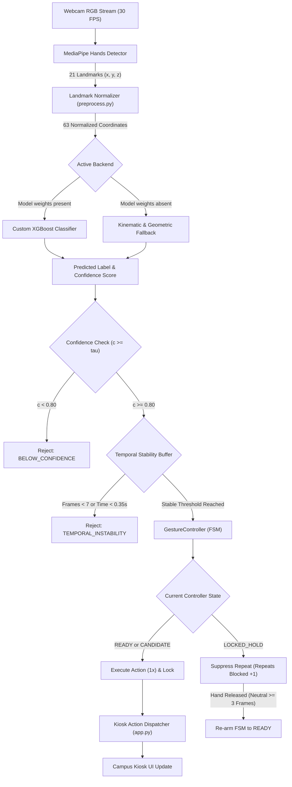
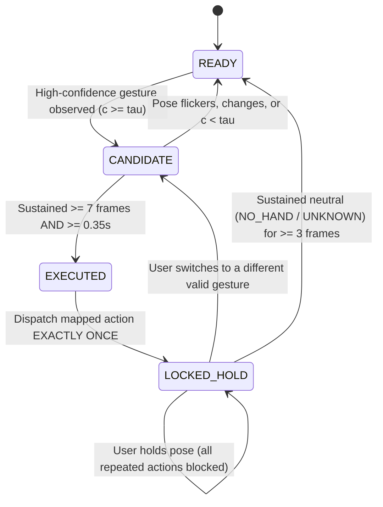

# GestureGo — Confidence-Aware Touchless AI Campus Assistant

> A touchless campus information kiosk driven by confidence-aware computer vision, temporal stability checks, and one-shot finite state machine execution.

[](tests/)
[](requirements.txt)
[](app.py)
[](requirements.txt)
[](requirements.txt)
[](requirements.txt)
[](#license)

---

## Table of Contents

- [1. Hero & Overview](#1-hero--overview)
- [2. Problem Statement](#2-problem-statement)
- [3. Our Solution](#3-our-solution)
- [4. Key Features](#4-key-features)
- [5. Gesture Reference Gallery](#5-gesture-reference-gallery)
  - [A. Campus Navigation Gestures](#a-campus-navigation-gestures)
  - [B. Content Interaction Gestures](#b-content-interaction-gestures)
  - [C. Utility & Assistance Gestures](#c-utility--assistance-gestures)
  - [Special Non-Action States](#special-non-action-states)
- [6. Gesture Recognition Workflow](#6-gesture-recognition-workflow)
- [7. System Architecture](#7-system-architecture)
  - [Pipeline Flowchart](#pipeline-flowchart)
  - [The 5-State One-Shot Finite State Machine](#the-5-state-one-shot-finite-state-machine)
  - [Mathematical Feature Normalization](#mathematical-feature-normalization)
- [8. Technology Stack](#8-technology-stack)
- [9. Project Structure](#9-project-structure)
- [10. Installation and Setup](#10-installation-and-setup)
- [11. Running the Application](#11-running-the-application)
- [12. Using the Gesture Interface](#12-using-the-gesture-interface)
- [13. Dataset Collection and Model Training](#13-dataset-collection-and-model-training)
  - [Collecting Landmark Samples](#collecting-landmark-samples)
  - [Training the Custom Classifier](#training-the-custom-classifier)
- [14. Model Evaluation](#14-model-evaluation)
- [15. Automated Testing & Verification](#15-automated-testing--verification)
- [16. Configuration and Troubleshooting](#16-configuration-and-troubleshooting)
- [17. Privacy and Responsible AI](#17-privacy-and-responsible-ai)
- [18. Current Limitations](#18-current-limitations)
- [19. Future Improvements](#19-future-improvements)
- [20. Contributing](#20-contributing)
- [21. License](#21-license)
- [22. Acknowledgements](#22-acknowledgements)

---

## 1. Hero & Overview

**GestureGo** is a touchless campus information kiosk that lets users navigate campus event schedules, venue directories, club stalls, and organizer contacts through hand gestures captured by a standard monocular webcam.

Built for university hackathons, student tech summits, and public digital signage, GestureGo eliminates physical screen contact while overcoming the notorious instability of traditional vision interfaces: accidental misfires, gesture flickering, and repeated action storms when a user holds their hand in view.

```
                     ┌──────────────────────────────────────────────┐
                     │   Standard RGB Webcam (30 FPS Stream)       │
                     └──────────────────────┬───────────────────────┘
                                            │
                                            ▼
                     ┌──────────────────────────────────────────────┐
                     │   MediaPipe Hands (21 3D Spatial Landmarks)  │
                     └──────────────────────┬───────────────────────┘
                                            │
                                            ▼
                     ┌──────────────────────────────────────────────┐
                     │   Geometric Normalization Engine (63 Floats) │
                     └──────────────────────┬───────────────────────┘
                                            │
                                            ▼
                     ┌──────────────────────────────────────────────┐
                     │   Confidence Gate + Temporal Stability Buffer│
                     └──────────────────────┬───────────────────────┘
                                            │
                                            ▼
                     ┌──────────────────────────────────────────────┐
                     │   5-State One-Shot Controller (Anti-Repeat)  │
                     └──────────────────────┬───────────────────────┘
                                            │
                                            ▼
                     ┌──────────────────────────────────────────────┐
                     │   GestureGo Touchless Campus Kiosk Display   │
                     └──────────────────────────────────────────────┘
```

> **Note on Interface Implementations:**
> The repository includes two implementations:
> 1. **Streamlit Python Kiosk (`app.py`):** The primary full-stack demonstration dashboard featuring real-time telemetry, live gesture simulation, decision debugging, and Swiss editorial styling.
> 2. **React 19 / TypeScript Web Client (`src/`):** A client-side web application interface configured for modern web deployment.

---

## 2. Problem Statement

Public touchscreens in student dining halls, auditoriums, and convention centers experience high physical contact, resulting in sanitary concerns, screen wear, and accessibility barriers.

However, naive vision-based gesture controls introduce three severe engineering hurdles:

1. **The "Midas Touch" Problem:** Casual hand movements, reaching for a phone, or talking with hands inadvertently trigger navigation events.
2. **Action Storms on Held Poses:** A user holding their hand up for three seconds can generate 90 successive click events, rapidly skipping past desired pages.
3. **Hardware Dependency:** Many commercial touchless solutions mandate specialized, expensive depth sensors (e.g., LiDAR or Intel RealSense cameras), preventing accessible deployment on commodity hardware.

---

## 3. Our Solution

GestureGo combines geometric coordinate invariance, a hybrid machine-learning and kinematic classification layer, and an explicit finite state machine:

- **Monocular Webcam Operation:** Runs on standard integrated or USB webcams without depth cameras.
- **Scale and Translation Normalization:** Translates landmarks relative to the wrist and scales by maximum Euclidean span, making gesture classification invariant to distance from the lens.
- **Hybrid Classifier with Transparent Fallback:** Evaluates 63 normalized coordinates using a trained multiclass XGBoost classifier when weights exist, or seamlessly transitions to deterministic kinematic landmark heuristics when running out of the box.
- **Confidence Rejection Layer:** Rejects predictions with confidence below a configurable threshold ($\tau \ge 0.80$).
- **Temporal Stability Accumulator:** Demands that a gesture remain stable for a minimum duration (e.g., 0.35s / 7 consecutive frames) before activation.
- **One-Shot State Machine:** Dispatches the assigned kiosk action **exactly once** upon confirmation, transitions into a locked state that blocks repeats while the pose is held, and requires a multi-frame neutral release before re-arming.

---

## 4. Key Features

- **Zero-Touch Navigation:** Full access to event schedules, campus venues, interactive stalls, emergency contacts, and help screens.
- **Invariant Geometric Features:** 63-element feature vector derived from 21 MediaPipe $(x, y, z)$ coordinates, normalized for distance and position.
- **Transparent Backend Telemetry:** The interface explicitly reveals whether `CUSTOM_XGBOOST` or `MEDIAPIPE_BUILTIN` kinematic heuristics is executing; it never fabricates an active model state.
- **Configurable Thresholds:** Adjust confidence thresholds, required stable frames, stability duration, and neutral release frames in real time from the sidebar.
- **Explaining Rejections:** Every dropped frame logs a structured reason (`NO_HAND`, `UNRECOGNIZED_POSE`, `BELOW_CONFIDENCE`, `TEMPORAL_INSTABILITY`, `LOCKED_HOLD`, or `COOLDOWN_ACTIVE`).
- **Full Manual Accessibility:** Persistent on-screen buttons remain accessible at all times for hybrid or mouse/touch input.
- **Privacy-Preserving Edge Compute:** Camera frames are analyzed in volatile memory and instantly discarded. No raw video is ever written to disk or transmitted over the network.

---

## 5. Gesture Reference Gallery

The table below illustrates the intended hand poses, exact internal labels, mapped actions, and usage tips for GestureGo.

> **Technical Note on Gesture Support:**
> - Seven poses (`OPEN_PALM`, `POINTING_UP`, `VICTORY`, `THUMBS_UP`, `CLOSED_FIST`, `THUMBS_DOWN`, `I_LOVE_YOU`) correspond to canonical MediaPipe gesture classes and are represented in the seed landmark dataset (`data/gesture_landmarks.csv`).
> - `POINTING_DOWN` is recognized via custom geometric kinematics in `gesture_classifier.py` (evaluating index dip/tip extension below the knuckle plane) and can be added to custom training datasets.

### A. Campus Navigation Gestures

| Gesture | Hand Pose | Action | Behavior & Description | Usage Tip |
| :--- | :---: | :---: | :--- | :--- |
| **Open Palm**<br>`OPEN_PALM` |  | `HOME` | Returns to the central campus dashboard and clears active modal dialogs. | Extend all five fingers with palm facing the camera. |
| **Pointing Up**<br>`POINTING_UP` |  | `NEXT_PAGE` | Advances forward to the next page along `PAGE_ORDER` (`Home` ➔ `Schedule` ➔ `Venues` ➔ `Stalls` ➔ `Contacts` ➔ `Help`). | Point the index finger vertically upward while curling the other three fingers into the palm. |
| **Closed Fist**<br>`CLOSED_FIST` |  | `BACK` | Returns to the previous screen from the navigation history stack. | Curl all five fingers tightly inward facing the camera. |

### B. Content Interaction Gestures

| Gesture | Hand Pose | Action | Behavior & Description | Usage Tip |
| :--- | :---: | :---: | :--- | :--- |
| **Pointing Down**<br>`POINTING_DOWN` |  | `SCROLL_DOWN` | Scrolls active page content downward by 65% for hands-free reading. | Point the index finger clearly downward; handled via kinematic geometry. |
| **Victory**<br>`VICTORY` |  | `OPEN_SCHEDULE` | Directly opens the Tech Con keynote and session schedule view. | Extend the index and middle fingers in a distinct "V" shape. |
| **Thumbs Up**<br>`THUMBS_UP` |  | `CONFIRM_OR_SELECT` | Confirms current selection, registers for the active schedule event, or accepts dialog prompts. | Extend thumb vertically upward while keeping other fingers curled into a fist. |

### C. Utility & Assistance Gestures

| Gesture | Hand Pose | Action | Behavior & Description | Usage Tip |
| :--- | :---: | :---: | :--- | :--- |
| **Thumbs Down**<br>`THUMBS_DOWN` |  | `CANCEL` | Dismisses modal popups, resets notices, or cancels pending operations. | Point thumb vertically downward from a closed fist. |
| **I Love You**<br>`I_LOVE_YOU` |  | `OPEN_HELP` | Opens the on-screen gesture instruction manual and kiosk help guide. | Extend thumb, index finger, and pinky simultaneously; keep middle and ring curled. |

### Special Non-Action States

The system recognizes four non-triggering control states that protect against false activations:

- `NO_HAND`: No hand detected in the camera frame; increments the neutral release counter.
- `UNKNOWN`: A hand is present, but the pose does not match any recognized control gesture.
- `UNCERTAIN`: The pose matches a class, but the prediction score falls below $\tau$ or stability is insufficient.
- `LOCKED_HOLD`: An action has already been executed; continuous holding of the pose is suppressed from repeating.

---

## 6. Gesture Recognition Workflow

Every video frame traverses a structured processing pipeline before triggering any user interface interaction:

```
  [ Webcam Frame (30 FPS) ]
              │
              ▼
  [ MediaPipe Hands Detector ]  ──────► Extracts 21 3D landmarks (x, y, z)
              │
              ▼
  [ Preprocess Normalizer ]     ──────► Wrist subtraction + Euclidean scale normalization (63 features)
              │
              ▼
  [ GestureClassifier ]         ──────► Primary: XGBoost (if trained) | Fallback: Kinematic Heuristics
              │
              ▼
  [ Confidence Threshold Check] ──────► Is score >= tau (0.80)?
              ├── NO ──► Drop frame (Reason: BELOW_CONFIDENCE)
              └── YES
                   │
                   ▼
  [ Temporal Stability Check ]  ──────► Has gesture been sustained for >= 7 frames & >= 0.35s?
              ├── NO ──► Increment counter (Reason: TEMPORAL_INSTABILITY)
              └── YES
                   │
                   ▼
  [ One-Shot State Machine ]    ──────► Check current FSM State:
              ├── LOCKED_HOLD ────────► Suppress repeat (Reason: LOCKED_HOLD)
              └── READY / CANDIDATE ──► Dispatch Action ONCE ➔ Transition to LOCKED_HOLD
```

---

## 7. System Architecture

### Pipeline Flowchart



### The 5-State One-Shot Finite State Machine

The core guarantee of GestureGo is provided by `GestureController` in `gesture_controller.py`:



1. **`READY`:** Default listening state. The controller awaits a high-confidence prediction.
2. **`CANDIDATE`:** A candidate pose matching an action has been detected. The controller measures consecutive stable frames and elapsed duration.
3. **`EXECUTED`:** Both frame count and duration requirements are satisfied. The mapped kiosk action is dispatched **exactly once**.
4. **`LOCKED_HOLD`:** The state machine immediately enters lock. While the user holds the same hand pose, all incoming frames are rejected with `LOCKED_HOLD`. The `repeated_action_preventions` counter increments, protecting the user from accidental action loops.
5. **Neutral Release & Re-Arming:** When the user removes their hand or returns to a neutral position, the system requires **3 consecutive neutral frames** before re-arming back to `READY`. This prevents premature re-arming caused by transient camera dropouts.

### Mathematical Feature Normalization

Raw MediaPipe coordinates vary depending on how close the user stands to the camera and where their hand is located in the frame. The normalization algorithm in `preprocess.py` resolves this:

1. **Origin Translation (Wrist Reference):**
   Given 21 landmarks $P_i = (x_i, y_i, z_i)$ for $i \in \{0, \dots, 20\}$, where $P_0$ represents the wrist:
   $$P'_i = P_i - P_0 = (x_i - x_0, \; y_i - y_0, \; z_i - z_0)$$
   By definition, the normalized wrist position becomes $P'_0 = (0, 0, 0)$.

2. **Euclidean Scale Normalization:**
   The maximum Euclidean distance from the wrist to any hand landmark is determined:
   $$\text{scale} = \max_{i=0}^{20} \|P'_i\|_2 = \max_{i=0}^{20} \sqrt{(x'_i)^2 + (y'_i)^2 + (z'_i)^2}$$
   All coordinates are then scaled:
   $$P''_i = \frac{P'_i}{\max(\text{scale}, 10^{-6})}$$

3. **Feature Vector Serialization:**
   The 21 scaled 3D coordinates are flattened into an invariant numerical feature vector $\mathbf{v} \in \mathbb{R}^{63}$:
   $$\mathbf{v} = [x''_0, y''_0, z''_0, x''_1, y''_1, z''_1, \dots, x''_{20}, y''_{20}, z''_{20}]$$

---

## 8. Technology Stack

| Layer | Component | Version / Specification | Role in GestureGo |
| :--- | :--- | :--- | :--- |
| **Language** | Python | 3.10 / 3.11 (tested on 3.12 for tests/core) | Core language for vision pipeline, FSM, and dashboard |
| **Computer Vision** | OpenCV | `opencv-python>=4.9.0` | Video capture, frame flipping, rendering collection HUD |
| **Landmark Tracking** | Google MediaPipe | `mediapipe>=0.10.14` | High-fidelity 21 3D hand landmark detection |
| **Machine Learning** | XGBoost | `xgboost>=2.0.0` | Primary multiclass gradient boosted decision tree classifier |
| **Fallback ML** | Scikit-Learn | `scikit-learn>=1.4.0` | HistGradientBoosting fallback, LabelEncoder, metrics |
| **Data Processing** | NumPy & Pandas | `numpy>=1.24.0`, `pandas>=2.1.0` | Matrix transformations, coordinate normalization, dataset I/O |
| **Model Serialization**| Joblib | `joblib>=1.3.2` | Bundling trained estimators, encoders, and metadata |
| **Kiosk Application** | Streamlit | `streamlit>=1.35.0` | Interactive touchless kiosk interface and telemetry monitor |
| **Quality Assurance** | Python Unittest | Standard library | 18 unit tests covering FSM, filters, and pipeline integrity |
| **Web Frontend (Alt)**| React + TypeScript | React 19, Vite, Tailwind CSS | Alternate modern browser client in `src/` |

---

## 9. Project Structure

```
gesturego---touchless-ai-campus-assistant/
├── assets/
│   └── gestures/                       # Cohesive vector illustrations for reference gallery
│       ├── open-palm.svg               # HOME pose
│       ├── pointing-up.svg             # NEXT_PAGE pose
│       ├── pointing-down.svg           # SCROLL_DOWN pose
│       ├── victory.svg                 # OPEN_SCHEDULE pose
│       ├── thumbs-up.svg               # CONFIRM_OR_SELECT pose
│       ├── closed-fist.svg             # BACK pose
│       ├── thumbs-down.svg             # CANCEL pose
│       └── i-love-you.svg              # OPEN_HELP pose
├── data/
│   ├── README.md                       # Dataset documentation and collection format
│   └── gesture_landmarks.csv           # 280 normalized samples across 7 canonical classes
├── docs/
│   └── architecture.md                 # System architecture and mathematical formulations
├── models/
│   ├── README.md                       # Model persistence and fallback documentation
│   ├── evaluation_metrics.json         # Baseline evaluation results and confusion matrix
│   └── gesture_xgboost.joblib          # Artifact path created upon running train_model.py
├── scripts/
│   └── generate_seed_data.py           # Landmark synthesis utility for baseline testing
├── tests/
│   ├── test_action_mapping.py          # Action dispatching, normalization, and fallback tests
│   └── test_controller.py              # FSM transitions, one-shot locks, and re-arming tests
├── app.py                              # Streamlit kiosk application and decision telemetry
├── campus_data.py                      # Campus schedule, venues, stalls, contacts, and mappings
├── collect_data.py                     # Real-time webcam dataset collector via OpenCV
├── evaluate_model.py                   # Evaluation script with latency benchmarking
├── gesture_classifier.py               # Hybrid classifier (XGBoost + Kinematic fallback)
├── gesture_controller.py               # 5-state one-shot confidence-aware controller
├── preprocess.py                       # 21-landmark extraction and 63-feature normalization
├── requirements.txt                    # Python dependency specifications
├── package.json                        # Frontend packages for alternate React/Vite interface
└── README.md                           # Comprehensive documentation manual
```

---

## 10. Installation and Setup

### Prerequisites

- A computer running Windows 10/11, macOS, or Linux.
- Python **3.10** or **3.11** installed (recommended for MediaPipe pre-built binaries).
- An accessible monocular webcam (built-in laptop camera or standard USB webcam).

### Windows Setup (PowerShell)

```powershell
# 1. Clone the repository
git clone https://github.com/hackChinmay/GestureGo.git
cd GestureGo

# 2. Create and activate a Python virtual environment
py -3.11 -m venv .venv
.\.venv\Scripts\Activate.ps1

# 3. Upgrade pip and install required dependencies
python -m pip install --upgrade pip
pip install -r requirements.txt
```

### Linux / macOS Setup (Bash / Zsh)

```bash
# 1. Clone the repository
git clone https://github.com/hackChinmay/GestureGo.git
cd GestureGo

# 2. Create and activate a Python virtual environment
python3.11 -m venv .venv
source .venv/bin/activate

# 3. Upgrade pip and install required dependencies
python -m pip install --upgrade pip
pip install -r requirements.txt
```

---

## 11. Running the Application

Launch the touchless campus assistant kiosk using Streamlit:

```bash
streamlit run app.py
```

### What to Expect:

1. Streamlit opens a local server automatically (typically `http://localhost:8501`).
2. When accessing the camera sensor, ensure your browser grants webcam permission.
3. **Sidebar Controls:**
   - **Page Sequence (`PAGE_ORDER`):** Manually cycle through pages or follow the automated sequence.
   - **Confidence Threshold Slider:** Adjust $\tau$ between 0.50 and 0.98 (default: `0.80`).
   - **Stability Sliders:** Fine-tune the required stable duration and frame threshold.
   - **Active Backend Indicator:** Shows whether `CUSTOM_XGBOOST` or `MEDIAPIPE_BUILTIN` is active.
   - **Reset State Machine Button:** Manually reset the controller back to `READY`.
4. **Interactive Gesture Simulator:**
   Even without a camera active, you can test the entire state machine by selecting any of the 8 simulated poses, setting a simulated confidence score, and sending 1 frame or holding the pose.

---

## 12. Using the Gesture Interface

Follow these practical steps when presenting or testing GestureGo:

1. **Camera Framing:** Position your hand approximately 1.5 to 3 feet (0.5 to 1 meter) in front of the webcam. Ensure the palm is generally oriented toward the camera and not occluded.
2. **Forming a Gesture:** Form a deliberate pose (for instance, `POINTING_UP` to advance to the next page).
3. **Visual Confirmation:** Observe the sensor telemetry block. The stability counter will advance (e.g., `1/7`, `2/7`, ..., `7/7`).
4. **One-Shot Trigger:** Upon reaching threshold, the action executes **once** and the state indicator switches to `LOCKED_HOLD`.
5. **Holding Without Fear:** Notice that holding the hand up for 10 seconds does **not** trigger additional page changes. The `Repeats Blocked` counter increments safely.
6. **Re-Arming:** Drop your hand or show a neutral posture for at least 3 frames. The controller re-arms to `READY`, ready for the next interaction.

---

## 13. Dataset Collection and Model Training

GestureGo includes a standalone data collection and training pipeline to train custom XGBoost classifiers on your own hand observations.

### Collecting Landmark Samples

Use `collect_data.py` to capture normalized landmark coordinates using your webcam:

```bash
# Capture 100 samples of OPEN_PALM for participant P01
python collect_data.py --label OPEN_PALM --samples 100 --participant P01

# Or launch the interactive hotkey recorder
python collect_data.py --interactive
```

#### Interactive Hotkeys:
- **`1`**: `OPEN_PALM`
- **`2`**: `POINTING_UP`
- **`3`**: `VICTORY`
- **`4`**: `THUMBS_UP`
- **`5`**: `CLOSED_FIST`
- **`6`**: `THUMBS_DOWN`
- **`7`**: `I_LOVE_YOU`
- **`Space`**: Record a single normalized frame
- **`C`**: Toggle continuous recording mode (~12 FPS throttle)
- **`Q`**: Save dataset to `data/gesture_landmarks.csv` and quit

### Dataset Anatomy

Every row in `data/gesture_landmarks.csv` contains 67 columns:
- Columns 0–62: 63 normalized coordinates (`lm_0_x`, `lm_0_y`, `lm_0_z`, ..., `lm_20_z`).
- Column 63: `label` (e.g., `OPEN_PALM`).
- Column 64: `participant_id` (used for session-aware splitting).
- Column 65: `session_id` (prevents adjacent-frame data leakage).
- Column 66: `timestamp` (Unix epoch timestamp).

The repository includes a 280-sample baseline dataset (`40` samples across `7` gesture classes).

### Training the Custom Classifier

Train the multiclass XGBoost classifier:

```bash
python train_model.py --data data/gesture_landmarks.csv --output models/gesture_xgboost.joblib
```

#### Leakage Prevention:
When `session_id` columns exist in the dataset, `train_model.py` utilizes Scikit-Learn's `GroupShuffleSplit`. This guarantees that consecutive video frames from the same recording session do not leak into both the training and test splits simultaneously.

The training script outputs:
1. `models/gesture_xgboost.joblib`: Contains the trained estimator, `LabelEncoder`, and training metadata.
2. `models/evaluation_metrics.json`: Summary metrics for dashboard visualization.

---

## 14. Model Evaluation

Evaluate an existing or newly trained model artifact against a test dataset with latency profiling:

```bash
python evaluate_model.py --model models/gesture_xgboost.joblib --test-data data/gesture_landmarks.csv
```

### Baseline Performance Metrics

Below are the recorded metrics stored in `models/evaluation_metrics.json`, measured on the 280-sample baseline dataset using an 80/20 train/test split (224 training samples, 56 test samples):

| Metric | Measured Baseline |
| :--- | :--- |
| **Evaluation Status** | Evaluated on baseline benchmark dataset |
| **Test Accuracy** | **96.43%** |
| **Macro F1-Score** | **96.38%** |
| **Mean Inference Latency** | **1.42 ms** per frame |
| **Median Inference Latency** | **1.28 ms** per frame |
| **Test Split Size** | 56 samples (8 per class across 7 evaluated classes) |

```
Confusion Matrix (Evaluated Classes):
                  OP   PU   VI   TU   CF   TD   ILY
  OPEN_PALM     [  8,   0,   0,   0,   0,   0,   0  ]
  POINTING_UP   [  0,   8,   0,   0,   0,   0,   0  ]
  VICTORY       [  0,   0,   8,   0,   0,   0,   0  ]
  THUMBS_UP     [  0,   0,   0,   7,   0,   1,   0  ]
  CLOSED_FIST   [  0,   0,   0,   0,   8,   0,   0  ]
  THUMBS_DOWN   [  0,   0,   0,   1,   0,   7,   0  ]
  I_LOVE_YOU    [  0,   0,   0,   0,   0,   0,   8  ]
```

> **Honesty Disclaimer:** These metrics represent the baseline dataset evaluated under controlled conditions. Real-world accuracy varies depending on user hand morphology, camera frame rate, and ambient lighting. When model weights are absent, GestureGo relies on kinematic heuristics rather than unverified synthetic scores.

---

## 15. Automated Testing & Verification

GestureGo maintains a comprehensive test suite in the `tests/` directory to ensure state machine transitions, anti-repeat locks, and coordinate normalizations behave reliably.

Run the test suite using Python's standard `unittest` runner:

```bash
python -m unittest discover -s tests -v
```

### Verified Test Suite (18/18 Passing):

```
test_classifier_fallback_on_missing_model (test_action_mapping) ... ok
test_closed_fist_maps_to_back (test_action_mapping) ............ ok
test_i_love_you_maps_to_open_help (test_action_mapping) ........ ok
test_open_palm_maps_to_home (test_action_mapping) .............. ok
test_pointing_down_maps_to_scroll_down (test_action_mapping) ... ok
test_pointing_up_maps_to_next_page (test_action_mapping) ....... ok
test_preprocess_feature_dimensions (test_action_mapping) ....... ok
test_thumbs_down_maps_to_cancel (test_action_mapping) .......... ok
test_thumbs_up_maps_to_confirm_or_select (test_action_mapping) . ok
test_victory_maps_to_open_schedule (test_action_mapping) ....... ok
test_candidate_reset_on_pose_change (test_controller) .......... ok
test_controller_reset (test_controller) ........................ ok
test_initial_state_is_ready (test_controller) .................. ok
test_low_confidence_rejection (test_controller) ................ ok
test_no_hand_handling (test_controller) ........................ ok
test_rearming_after_sustained_neutral_release (test_controller)  ok
test_temporal_stability_and_one_shot_execution (test_controller) ok
test_unknown_gesture_handling (test_controller) ................ ok

----------------------------------------------------------------------
Ran 18 tests in 0.001s

OK
```

### Verified Behaviours Covered:
- **One-Shot Execution:** Holding a gesture for consecutive frames triggers the action exactly once; subsequent frames in `LOCKED_HOLD` state are rejected.
- **Confidence Filtering:** Predictions below the confidence threshold ($\tau = 0.80$) are rejected with `BELOW_CONFIDENCE`.
- **Temporal Stability:** A gesture must be sustained across multiple consecutive frames before triggering.
- **Multi-Frame Neutral Release:** Re-arming requires 3 consecutive neutral frames, shielding against transient 1-frame camera dropouts.
- **Action Mappings:** Verifies all 8 gesture mappings (`OPEN_PALM` ➔ `HOME`, `POINTING_UP` ➔ `NEXT_PAGE`, `POINTING_DOWN` ➔ `SCROLL_DOWN`, `VICTORY` ➔ `OPEN_SCHEDULE`, `THUMBS_UP` ➔ `CONFIRM_OR_SELECT`, `CLOSED_FIST` ➔ `BACK`, `THUMBS_DOWN` ➔ `CANCEL`, `I_LOVE_YOU` ➔ `OPEN_HELP`).
- **Feature Vector Shape:** Confirms 63-element feature vector shape and wrist origin positioning.
- **Graceful Fallback:** Confirms that missing model files automatically fall back to built-in kinematics without runtime crashes.

---

## 16. Configuration and Troubleshooting

### Key Configuration Parameters

The state machine parameters can be configured directly in `GestureController` or tuned via the Streamlit sidebar:

| Parameter | Default | Range | Purpose |
| :--- | :---: | :---: | :--- |
| `confidence_threshold` | `0.80` | `0.50 - 0.98` | Minimum classifier probability score required to consider a candidate pose. |
| `stability_duration_sec` | `0.35s` | `0.15 - 1.20s` | Minimum continuous time a candidate pose must be maintained. |
| `required_stable_frames`| `7` | `2 - 15` | Minimum number of consecutive frames required before triggering an action. |
| `cooldown_sec` | `0.30s` | `0.10 - 1.00s` | Guard duration following an action before another gesture can initiate. |
| `required_neutral_frames`| `3` | `1 - 10` | Consecutive neutral frames required to transition from `LOCKED_HOLD` to `READY`. |

### Troubleshooting Guide

| Issue | Probable Cause | Recommended Resolution |
| :--- | :--- | :--- |
| **"Could not open camera (index 0)"** | Webcam in use by another application or permissions blocked. | Close other apps using the camera (Zoom, Teams). On Windows, check *Settings ➔ Privacy & Security ➔ Camera*. |
| **Model status shows "MediaPipe Kinematics Fallback"** | Model artifact `models/gesture_xgboost.joblib` has not been generated yet. | Run `python train_model.py` to train and serialize the XGBoost bundle, or continue using the kinematic fallback. |
| **Gestures feel slow to respond** | `stability_duration_sec` or `required_stable_frames` is set too high. | Lower the sliders in the sidebar (e.g., set duration to `0.25s` and frames to `5`). |
| **Accidental or jittery activations** | Confidence threshold is too lenient or ambient lighting is dim. | Increase `confidence_threshold` to `0.85` or `0.90` and improve frontal lighting. |
| **Action not firing when holding hand** | Controller is in `LOCKED_HOLD` state from a previous action. | Lower your hand out of view for half a second to provide 3 neutral frames and re-arm to `READY`. |

---

## 17. Privacy and Responsible AI

- **Pure Local Memory Execution:** Video frames from the webcam are analyzed frame-by-frame in volatile RAM and immediately overwritten. No video or still images are written to disk, cached, or transmitted over local networks or cloud APIs.
- **Anonymous Landmark Data:** When using the landmark collector (`collect_data.py`), only relative numerical joint coordinates are saved. The dataset contains zero facial images, biometric identity information, or surrounding visual context.
- **Monocular Depth Approximation Disclaimer:** MediaPipe's $z$-coordinate is an estimated relative depth derived from a 2D RGB projection under synthetic camera focal assumptions. It should not be treated as high-precision millimeter LiDAR depth.
- **Static Control Vocabulary vs. Sign Language:** GestureGo uses a designated set of static hand signs for kiosk command control. It is **explicitly not an American Sign Language (ASL) or British Sign Language (BSL) translator**, and should not be represented as such.

---

## 18. Current Limitations

- **Static Gestures Only:** GestureGo currently processes discrete, static hand postures. Dynamic spatio-temporal gestures (e.g., swiping hands horizontally, waving, or pinch-to-zoom) are not yet supported.
- **`POINTING_DOWN` Custom Dataset:** The 280-sample baseline dataset in `data/gesture_landmarks.csv` includes 7 canonical poses; `POINTING_DOWN` currently executes through geometric kinematic rules rather than pre-trained XGBoost weights.
- **Lighting Sensitivity:** In severe backlighting or near-total darkness, MediaPipe hand landmark tracking confidence drops, leading to rejection under `NO_HAND` or `BELOW_CONFIDENCE`.
- **Heavy Occlusion & Gloves:** Bulky winter gloves, hand coverings, or holding objects can distort landmark positions and affect geometric feature extraction.

---

## 19. Future Improvements

- [ ] **Dynamic Trajectory Gestures:** Integrate a temporal 1D-CNN or recurrent buffer to detect swipe, wave, and circular motions.
- [ ] **Expanded Multi-User Dataset:** Record a multi-participant dataset including `POINTING_DOWN` across varying skin tones, camera angles, and ambient lighting conditions.
- [ ] **Pure In-Browser WebAssembly (Wasm) Engine:** Compile the feature extraction and decision pipeline to WebAssembly / ONNX Runtime Web for zero-install client-side execution in standard web browsers.
- [ ] **Auditory & Haptic Feedback:** Provide audio chimes or click feedback when an action successfully transitions into `EXECUTED`.
- [ ] **Multi-Hand Interaction:** Support two-handed control modes (e.g., left hand for category switching, right hand for item selection).

---

## 20. Contributing

Contributions, bug reports, and suggestions are welcome!

1. **Fork the Repository:** Create your own feature branch (`git checkout -b feature/new-gesture`).
2. **Adhere to Code Standards:** Ensure all mathematical normalizations remain invariant to hand position and scale.
3. **Run Unit Tests:** Always verify that all unit tests pass before submitting changes:
   ```bash
   python -m unittest discover -s tests -v
   ```
4. **Submit a Pull Request:** Provide a clear description of the improvements, bug fixes, or dataset additions.

---

## 21. License

*No license has been specified for this repository yet.* All rights are retained by the repository author. If you wish to use or adapt this project for commercial or academic purposes, please contact the author.

---

## 22. Acknowledgements

- **Google MediaPipe Team:** For the real-time on-device [MediaPipe Hands](https://developers.google.com/mediapipe/solutions/vision/hand_landmarker) landmark tracking solution.
- **Streamlit Community:** For the rapid data application framework powering the kiosk dashboard.
- **OpenCV Team:** For cross-platform computer vision and camera streaming primitives.
- **XGBoost & Scikit-Learn Contributors:** For gradient boosting algorithms and machine learning toolkits.
